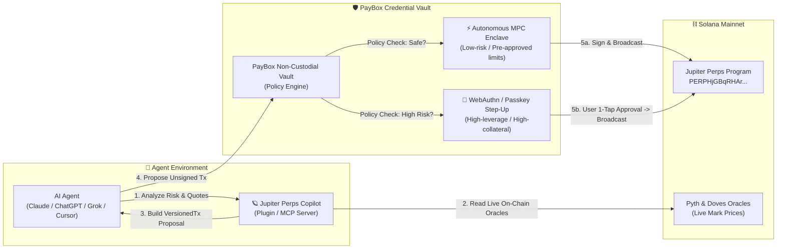

# PayBox Jupiter Perps Copilot 🪐

> Non-custodial leveraged trading, live oracle pricing, funding rate intelligence, and autonomous risk management for AI agents on Solana, built as a native plugin for the **[PayBox Marketplace](https://developer.paybox.sh/)** and **[Jupiter Perpetuals](https://station.jup.ag/docs/perpetual-exchange/overview)**.

[](https://developer.paybox.sh/)
[](https://modelcontextprotocol.io)
[](https://chatgpt.com)
[](https://developer.paybox.sh/)
[](https://solana.com)
[](https://opensource.org/licenses/MIT)

---

## ⚡ Overview & Mission

AI agents executing leveraged perpetual trades should **never hold raw private keys**. 

**PayBox Jupiter Perps Copilot** bridges AI agents and Solana DeFi by strictly separating **agent intelligence** from **financial authorization**:



1. **Market Intelligence & Risk Simulation**: Reads live on-chain oracles (Pyth & Doves) and custody accounts on Jupiter Perps to calculate borrow rates, open/close fees, and exact liquidation thresholds before any capital is committed.
2. **Deterministic `VersionedTransaction` Construction**: Automatically builds native Solana v0 transactions using Anchor IDL schemas (including ATA creation, WSOL wrapping, and PDA derivation).
3. **Non-Custodial Authorization via PayBox**: Returns standardized `io.paybox/transactionProposal` payloads. The agent never accesses private keys:
   - **Autonomous Mode**: Safe, low-risk positions execute directly inside MoonX MPC TEE enclaves without interrupting the user.
   - **Passkey-Gated Mode**: High-risk or large-margin trades trigger a 1-tap WebAuthn/Passkey step-up approval URL on the user's mobile device or browser.
4. **Universal Agent Compatibility**: Works across all agent architectures: PayBox Marketplace plugin (`dist/plugin.mjs`), Model Context Protocol (Stdio, SSE, Streamable HTTP), ChatGPT Custom GPT Actions (OpenAPI 3.1.0), and the x402 HTTP micropayment protocol.

---

## 🛠️ Exposed Plugin Tools

The plugin exposes 6 production-grade tools conforming to the official PayBox `PluginContract` specification (`contract_uri: "paybox://plugins/jupiter-perps"`):

| Tool | Category | Annotations | Description |
| :--- | :--- | :--- | :--- |
| [`jup_perps_get_quote`](#1-jup_perps_get_quote) | Risk Analysis | `readOnlyHint`, `idempotentHint` | Real-time quotes, margin requirements, liquidation price, and PayBox passkey policy checks. |
| [`jup_perps_get_markets`](#2-jup_perps_get_markets) | Market Data | `readOnlyHint`, `idempotentHint` | Tradable pairs (`SOL-PERP`, `BTC-PERP`, `ETH-PERP`), mark prices, max leverage, and borrow rates. |
| [`jup_perps_get_positions`](#3-jup_perps_get_positions) | Portfolio | `readOnlyHint`, `idempotentHint` | Discovers all open perpetual positions for any Solana wallet, with unrealized PnL and liquidation distance. |
| [`jup_perps_open_position`](#4-jup_perps_open_position) | Execution | `openWorldHint` | Constructs an Anchor increase-position transaction and returns an unsigned PayBox proposal. |
| [`jup_perps_close_position`](#5-jup_perps_close_position) | Execution | `openWorldHint` | Constructs an Anchor decrease/close-position transaction and returns an unsigned PayBox proposal. |
| [`jup_perps_simulate_onchain_tx`](#6-jup_perps_simulate_onchain_tx) | Verification | `readOnlyHint`, `openWorldHint` | Simulates any base64 VersionedTransaction against the live Solana Mainnet validator VM. |

---

### Tool Specifications

#### 1. `jup_perps_get_quote`
Calculates parameters for opening a leverage position using live Pyth oracles.
* **Inputs**:
  * `market`: `"SOL-PERP"` | `"BTC-PERP"` | `"ETH-PERP"`
  * `side`: `"long"` | `"short"`
  * `collateralUsd`: `number` (e.g. `50`)
  * `leverage`: `number` (e.g. `3` for 3x)
* **Output**:
  ```json
  {
    "market": "SOL-PERP",
    "side": "LONG",
    "markPrice": "$182.40",
    "collateral": "$50.00",
    "leverage": "3x",
    "totalPositionSize": "$150.00",
    "positionTokens": "0.8224",
    "estimatedOpenFee": "$0.09",
    "estimatedCloseFee": "$0.09",
    "liquidationPrice": "$124.03",
    "distanceToLiquidation": "32.00%",
    "riskLevel": "MODERATE_RISK",
    "payboxApprovalMode": "AUTONOMOUS (Pre-authorized inside MPC enclave)",
    "summary": "3x LONG on SOL-PERP with $50.00 collateral. Liquidation at $124.03 (32.0% away)."
  }
  ```

#### 2. `jup_perps_get_markets`
Fetches tradable markets, funding rates, and maximum leverage limits.
* **Inputs**: none (`{}`)
* **Output**: Array of active markets with mark prices, hourly borrow rates, and opening/closing fee basis points.

#### 3. `jup_perps_get_positions`
Inspects all active on-chain positions for a given Solana wallet.
* **Inputs**:
  * `walletAddress`: `string` (Solana base58 address)
* **Output**:
  * Array of active positions containing entry price, mark price, leverage, unrealized PnL ($ and %), liquidation price, and the on-chain `positionPubkey`.

#### 4. `jup_perps_open_position`
Generates an unsigned Solana `VersionedTransaction` (v0) proposal conforming to `io.paybox/transactionProposal`.
* **Inputs**:
  * `walletAddress`: `string` (Trader / fee payer public key)
  * `market`: `"SOL-PERP"` | `"BTC-PERP"` | `"ETH-PERP"`
  * `side`: `"long"` | `"short"`
  * `collateralUsd`: `number`
  * `leverage`: `number`
  * `collateralToken`: `"USDC"` | `"SOL"` (optional, default `"USDC"`)
  * `slippageBps`: `number` (optional, default `50` = 0.5%)
* **Output**: Standardized PayBox Solana transaction proposal envelope with a 4-minute expiry TTL:
  ```json
  {
    "structuredContent": {
      "io.paybox/transactionProposal": {
        "version": "1",
        "expiresAt": "2026-10-19T13:55:00Z",
        "kind": "solana",
        "chain": "solana:mainnet",
        "transaction": {
          "transactionBase64": "<base64_encoded_versioned_transaction>"
        }
      }
    }
  }
  ```

#### 5. `jup_perps_close_position`
Generates an unsigned transaction proposal to close or decrease an open position.
* **Inputs**:
  * `walletAddress`: `string` (Position owner base58 address)
  * `positionPubkey`: `string` (Jupiter position account public key)
  * `desiredReceiveToken`: `"USDC"` | `"SOL"` (optional, default `"USDC"`)
* **Output**: Standardized `io.paybox/transactionProposal` payload.

#### 6. `jup_perps_simulate_onchain_tx`
Directly submits any base64 VersionedTransaction to the live Solana Mainnet RPC node for VM simulation.
* **Inputs**:
  * `transactionBase64`: `string`
* **Output**:
  ```json
  {
    "success": true,
    "unitsConsumed": 34820,
    "err": null,
    "logs": [
      "Program PERPHjGBqRHArX4DySjwM6UJHiR3sWAatqfdBS2qQJu invoke [1]",
      "Program log: Instruction: CreateIncreasePositionMarketRequest",
      "Program PERPHjGBqRHArX4DySjwM6UJHiR3sWAatqfdBS2qQJu success"
    ]
  }
  ```

---

## 🚀 Quickstart & Installation

### 1. Requirements
* **Node.js**: v22+ (v24 recommended)
* **Package Manager**: `pnpm` (or `npm`)

### 2. Clone & Install
```bash
git clone <repo-url>
cd Juno
pnpm install
```

### 3. Environment Configuration
Create a `.env` file based on `.env.example`:
```bash
cp .env.example .env
```

| Variable | Description | Default |
| :--- | :--- | :--- |
| `SOLANA_RPC_URL` | Solana Mainnet RPC node endpoint | `https://api.mainnet-beta.solana.com` |
| `DEFAULT_SOLANA_WALLET` | Fallback wallet for CLI and simulation runs | (Included template address) |
| `DEFAULT_CREDENTIAL_ID` | Default PayBox credential ID | `crd_solana_primary` |
| `PORT` | HTTP server port for REST, SSE, and dashboard | `3000` |
| `x402_SOLANA_WALLET_ADDRESS` | Settlement address for x402 micropayments | (Included template address) |

---

## 🧪 Verification & Conformance

This plugin adheres to strict determinism and protocol compliance requirements:

```bash
# 1. Run determinism verification & official PayBox conformance suite
pnpm test

# 2. Run real live on-chain Solana Mainnet RPC VM simulation
pnpm run verify

# 3. Test all 6 live MCP tools over stdio
pnpm run test:live

# 4. TypeScript type checking
pnpm run typecheck
```

### Conformance Output Sample:
```json
{
  "reportVersion": 1,
  "starterVersion": "1.0.2",
  "protocolVersion": "2026-07-28",
  "status": "passed",
  "sampleCall": {
    "tool": "jup_perps_get_quote",
    "status": "passed"
  },
  "artifact": {
    "bytes": 1715525,
    "sha256": "d663389cf808fc7bb9c165cf3e2aeb8d578ad9cf52dbef009711452d4c296ac1"
  },
  "discoveredToolCount": 6
}
```

---

## 🤖 Connecting to AI Agents & Environments

### 1. PayBox Marketplace CLI
Run tools directly using the official `@paybox-sh/sdk` CLI:
```bash
# Inspect the discovered plugin contract
paybox plugins contract paybox://plugins/jupiter-perps

# Execute a quote via the discovered plugin
paybox plugins use jupiter-perps jup_perps_get_quote \
  --input '{"market":"SOL-PERP","side":"long","collateralUsd":50,"leverage":3}'
```

---

### 2. Claude Desktop & Cursor (Stdio MCP)
Add this to your `claude_desktop_config.json`:
```json
{
  "mcpServers": {
    "paybox-jupiter-perps": {
      "command": "node",
      "args": ["/absolute/path/to/Juno/dist/plugin.mjs"],
      "env": {
        "SOLANA_RPC_URL": "https://api.mainnet-beta.solana.com"
      }
    }
  }
}
```

---

### 3. Remote Web Agents (Claude Web / Grok / TypingMind)
Start the multi-transport server:
```bash
pnpm start
```
Connect using either endpoint:
* **Server-Sent Events (SSE)**: `http://localhost:3000/sse`
* **Streamable HTTP MCP**: `http://localhost:3000/mcp`

---

### 4. ChatGPT (Custom GPT Actions via OpenAPI 3.1.0)
1. Start the HTTP server: `pnpm start`
2. In ChatGPT, navigate to **Explore GPTs** → **Create a GPT** → **Configure** → **Actions** → **Create new action**.
3. Select **Import from URL** and enter:
   ```txt
   http://localhost:3000/openapi.json
   ```
   *(Or your public tunnel/deployment URL, e.g. `https://your-domain.com/openapi.json`)*
4. ChatGPT will discover all 6 typed tools. You can now prompt:
   * *"What is the current hourly funding rate for SOL-PERP on Jupiter?"*
   * *"Simulate a 3x Long on SOL with $50 collateral. What is my liquidation price?"*
   * *"Prepare an unsigned trade to open 2x Long SOL on Jupiter Perps."*

---

### 5. x402 Micropayments Protocol (HTTP 402 Fast-Lane)
Per [developer.paybox.sh](https://developer.paybox.sh/), PayBox natively speaks **x402**:
* `POST /x402/quote` (0.01 USDC fee)
* `POST /x402/trade` (0.05 USDC fee)

When called without payment, the server responds with `HTTP 402 Payment Required` and an `X-Accepts` header:
```http
HTTP/1.1 402 Payment Required
X-Accepts: {"network":"solana","asset":"USDC","amount_cents":1,"recipient":"..."}
Content-Type: application/json

{
  "error": "Payment Required",
  "protocol": "x402",
  "message": "PayBox x402 micropayment required (0.01 USDC). Call PayBox tool 'pay_x402' or 'use_service'."
}
```
Host agents with vaulted PayBox wallets automatically settle the fee using `pay_x402` or `use_service`.

---

### 6. Interactive Developer Dashboard
When running `pnpm start`, visit `http://localhost:3000` in your browser to access the built-in dark-mode developer dashboard with live market rates, test simulators, and documentation links.

---

## 🔒 Security & Policy Architecture

* **Zero Private Key Exposure**: The plugin operates in read-only and proposal-generation modes. It never asks for, receives, or persists private keys.
* **Deterministic Proposals**: Solana transactions are constructed with canonical base64 serialization and strict 4-minute expiry envelopes.
* **Fail-Closed Risk Guardrails**: If oracle feeds are stale or market conditions exceed safe parameters, trade preparation fails early before reaching the signing step.
* **Enclave & Passkey Signing**: All signature operations are delegated to PayBox's user-configured policies (MPC TEE enclaves for micro-trades, WebAuthn passkey step-up for larger positions).

---

## 📚 Technical References

* **PayBox Documentation**: [https://developer.paybox.sh](https://developer.paybox.sh)
* **Model Context Protocol**: [https://modelcontextprotocol.io](https://modelcontextprotocol.io)
* **Jupiter Perpetuals Program ID**: `PERPHjGBqRHArX4DySjwM6UJHiR3sWAatqfdBS2qQJu`
* **Jupiter Perpetuals Docs**: [https://station.jup.ag/docs/perpetual-exchange/overview](https://station.jup.ag/docs/perpetual-exchange/overview)
* **Solana Web3.js**: [https://solana-labs.github.io/solana-web3.js/](https://solana-labs.github.io/solana-web3.js/)

---

## ⚖️ License

Distributed under the **MIT License**. Built for the **MoonPay Hackathons: Chapter 1**.
